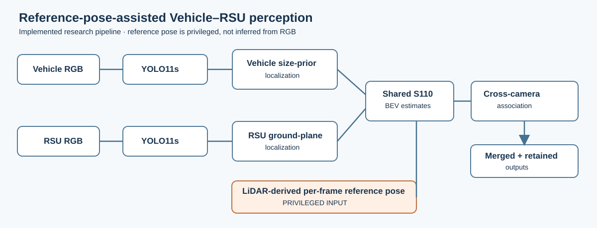
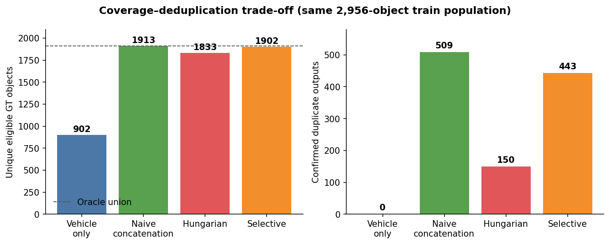
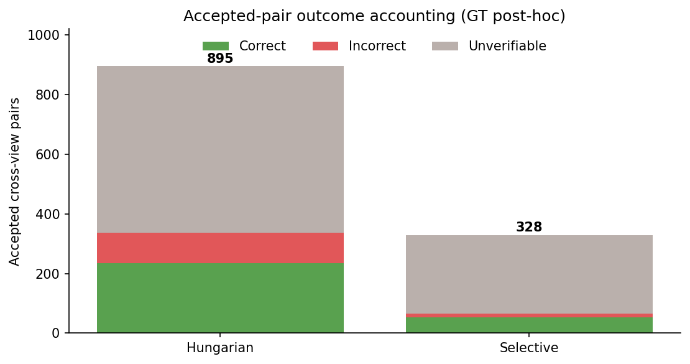
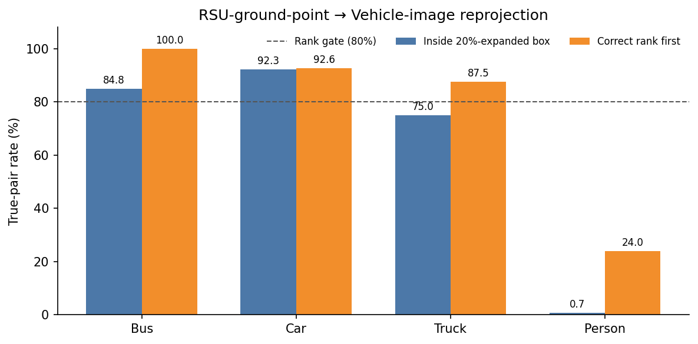
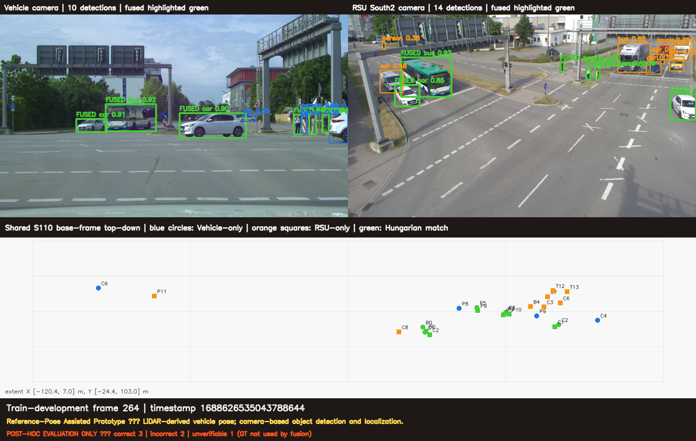
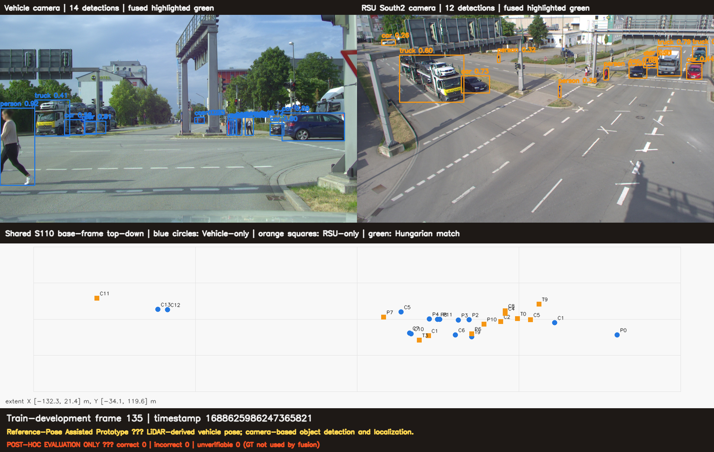
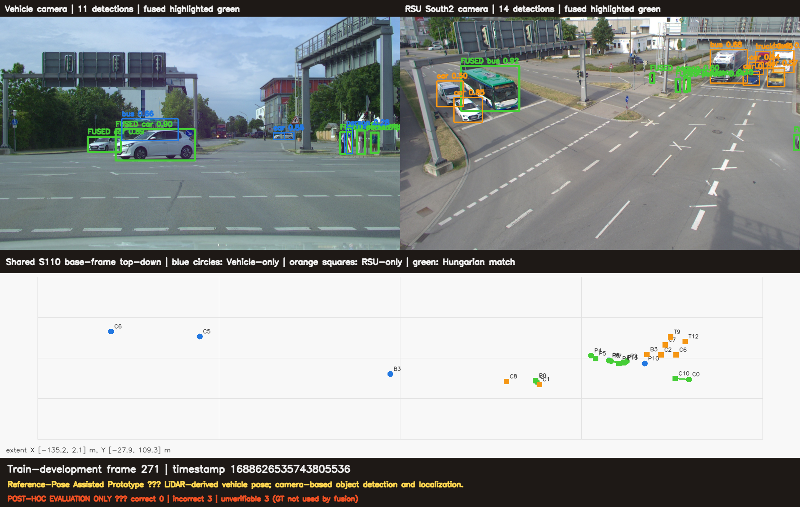

# Vehicle–Infrastructure Cooperative Perception

*Camera-Based Perception, Cross-View Association, and Relative Localization*

Vehicle cameras have limited fields of view, while a fixed Road-Side Unit (RSU) can observe complementary traffic. This project measures the RSU’s contribution and examines whether detections from the two views can be associated without discarding valid objects.

**Headline findings** on 400 TUMTraf-V2X mini-train development frames:

- Vehicle-only coverage: **30.51%** (902 of 2,956 eligible ground-truth object instances).
- Post-hoc, ground-truth-deduplicated Vehicle+RSU oracle union: **64.72%** (1,913 of 2,956). This is an offline coverage upper bound, not an operational fusion result.
- The RSU adds **1,011** eligible GT instances missed by the Vehicle camera.

> **Scientific scope.** The implemented prototype is reference-pose-assisted: it consumes a per-frame LiDAR-derived Vehicle-to-infrastructure pose. The Vehicle camera calibration is provisional. Results are train-development-only, with no held-out evaluation. Strict RGB-only relative pose and reliable camera-only cooperative fusion remain unresolved.

## System architecture and measured coverage



Vehicle and RSU RGB images feed frozen YOLO11s detectors. Vehicle detections use class-size-prior monocular localization; RSU detections use ground-plane localization. The LiDAR-derived reference pose aligns estimates in the shared S110 frame before cross-view association. This pose is a privileged inference input, not an RGB estimate.



## Experimental comparison

The eligible population consists of 2,956 supported-class GT objects whose projected cuboid intersects at least one camera image. GT identities are used after frozen inference for evaluation.

| Condition | Unique eligible GT covered | Coverage | Result |
|---|---:|---:|---|
| Vehicle-only | 902 / 2,956 | **30.51%** | Single-camera baseline |
| Vehicle + RSU oracle union | 1,913 / 2,956 | **64.72%** | Post-hoc GT deduplication; upper bound, not deployable fusion |
| Hungarian fusion | 1,833 / 2,956 | **62.01%** | Operational output; 80 fewer covered objects than the union |
| Selective fusion | 1,902 / 2,956 | **64.34%** | Operational output; pre-registered gate failed |

The fixed Hungarian spatial gate is **4 m**, with a **5.5 m exception for bus/truck pairs**. On 509 co-visible association opportunities, it produced 235 correct, 102 incorrect, and 558 unverifiable pairs. Verifiable precision was 69.73%; it removed duplicates at the cost of 80 covered objects and 102 known wrong merges.

The isolated-component selective rule accepted only unambiguous 1 Vehicle × 1 RSU graph components and retained other detections. It reduced known wrong merges to 12, but verifiable precision was 81.54%, below the pre-registered 90% target, and it removed 66 duplicates against a required 127. It therefore failed its utility and precision gate.

RSU ground-contact reprojection ranked the correct Vehicle counterpart first for 374/509 pairs (73.48%), below the 80% gate. Performance was class-dependent: 92.65% for cars, but 24.00% for persons, with pedestrian expanded-box containment of 0.67%. The all-class association cue was not sufficiently reliable.





Vehicle size-prior localization had 3.053 m conditional median XY error on 902 post-hoc matched Vehicle detections. This result depends on provisional calibration and privileged reference pose. Detailed definitions, caveats, and additional measured findings are in the [final technical report](docs/research/TUMTRAF_FINAL_TECHNICAL_REPORT.md), [evaluation protocol](docs/EVALUATION.md), and [negative-results record](docs/NEGATIVE_RESULTS.md). The [one-page research summary](docs/research/TUMTRAF_ONE_PAGE_SUPERVISOR_SUMMARY.md) provides a concise overview.

## Visual Examples

Selected representative outputs are included with permission for non-commercial academic and research presentation. They show mixed outcomes and complementary observations; association correctness was assessed post hoc.

**Mixed association outcomes (frame 264):** Vehicle/RSU detections and shared BEV, with correct, incorrect, and unverifiable matches.



**Complementary Vehicle/RSU detections (frame 135):** observations remain unmatched; this is not a claim of confirmed object recovery.



**Incorrect or unverifiable associations (frame 271):** a representative limitation of the geometric matching rule.



[Open the 1-second reference-pose-assisted demo video](examples/visual_demo/04_Reference_Pose_Demo.mp4). The example-level captions and attribution are in [`examples/visual_demo/README.md`](examples/visual_demo/README.md).
## Future research direction

**Proposed direction, not an implemented result:** investigate whether temporal static-scene RGB evidence can estimate a camera-derived relative-pose distribution, and whether uncertainty-aware association can preserve coverage by abstaining from risky merges. A future evaluation would need scene-disjoint sequences, independently validated image and calibration conventions, an RGB-only inference firewall, and pre-registered pose, precision, abstention, duplicate, false-merge, and coverage-loss criteria. See the [research proposal](docs/RESEARCH_PROPOSAL.md).

## Repository contents

```text
src/          perception, localization, and association modules
scripts/      inference, cached evaluations, figure generation, and audits
examples/     permissioned representative Vehicle/RSU visual outputs
tests/        synthetic aggregate-audit fixture
docs/         architecture, protocol, findings, reports, and proposal
figures/      architecture schematic and measured aggregate figures
results/      verified aggregate metrics and audit summaries
```

## Reproducibility and data sources

The included **synthetic fixture test** is dataset-free and does not need camera calibration or model weights. Run it after installing the listed dependencies:

```bash
python -m pip install -r requirements-release.txt
python -m pytest -q tests
```

The independent association utility in `src/release_baseline.py` operates on detections that have already been localized into a common 2D frame; the utility itself does not estimate that frame or perform camera calibration.

The archived Hungarian aggregate audit can be rerun only when its original per-frame association CSV and baseline summary are available; those intermediate records are not included. Cached fusion, selective-association, and reprojection evaluations also require frozen per-object detection, localization, assignment, and GT records that are not distributed. The detection-benefit inference script additionally requires the dataset, official calibration, YOLO11s weights, and archived Hungarian regression records. Therefore the repository does **not** provide a verified end-to-end reproduction of the reported dataset metrics from a clean checkout. The JSON metric snapshot and figures preserve the reported aggregates; they are not substitutes for the missing intermediate records.

The primary dataset is [TUMTraf-V2X](https://tum-traffic-dataset.github.io/tumtraf-v2x/), introduced by Zimmer *et al.*, [“TUMTraf V2X Cooperative Perception Dataset,” CVPR 2024](https://openaccess.thecvf.com/content/CVPR2024/papers/Zimmer_TUMTraf_V2X_Cooperative_Perception_Dataset_CVPR_2024_paper.pdf) (Technical University of Munich and Fraunhofer IVI). See the [official development kit](https://github.com/tum-traffic-dataset/tum-traffic-dataset-dev-kit), [data and licensing notes](docs/DATA_AND_LICENSES.md), and [third-party notices](THIRD_PARTY_NOTICES.md). The representative examples in [`examples/visual_demo/`](examples/visual_demo/README.md) are included with permission for non-commercial academic and research presentation; the full dataset and restricted source assets remain excluded.

Project source is provided under [AGPL-3.0](LICENSE). This license does not grant rights to TUMTraf data, annotations, calibration, poses, model weights, or derived media; obtain those independently under applicable terms.