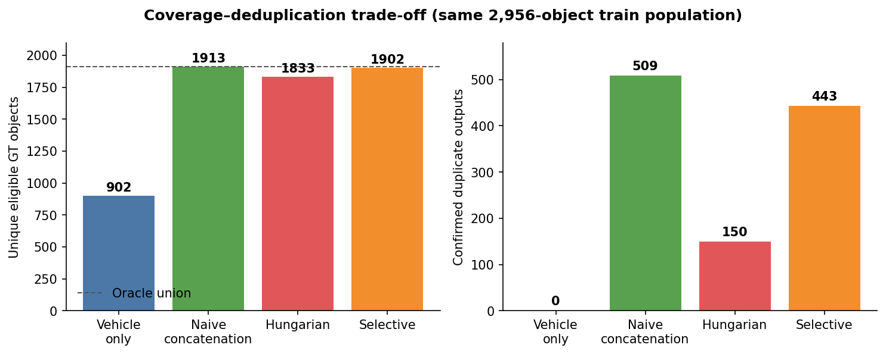
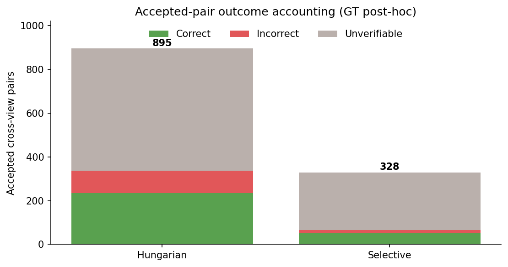
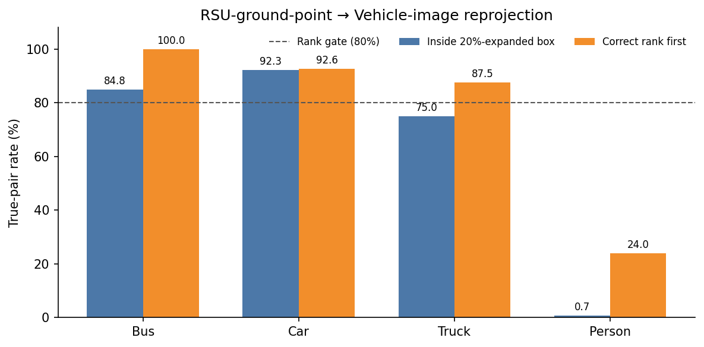
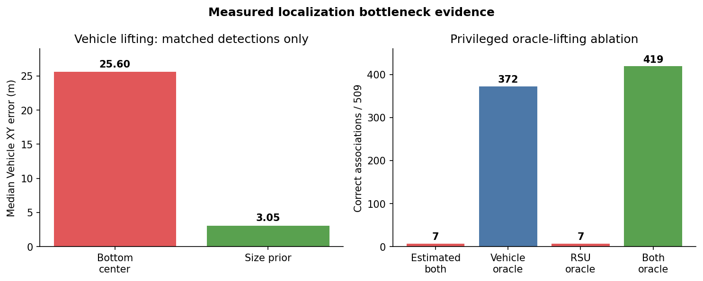

# TUMTraf-V2X: Camera-Based Vehicle–RSU Cooperative Perception

## Final technical research report

**Status:** completed train-development study; current association experiments closed.
**Scope:** 400 TUMTraf-V2X mini-train frames only. The test split was not accessed. Results are descriptive for temporally correlated development data, not held-out generalization.

## Abstract

This study separates two questions that are often conflated in cooperative perception: whether a Road-Side Unit (RSU) sees useful additional objects, and whether heterogeneous camera observations can be safely associated. Frozen YOLO11s Vehicle and RSU detections were evaluated with static calibration, Vehicle class-size-prior lifting, RSU ground-plane lifting, and a privileged per-frame LiDAR-derived Vehicle-to-infrastructure transform. The RSU demonstrably expands post-hoc detection coverage: Vehicle-only coverage is 902/2,956 eligible objects (30.51%), while the GT-deduplicated Vehicle+RSU union is 1,913/2,956 (64.72%). Yet geometry-only association is not reliable enough to safely deduplicate those observations. Global Hungarian association reduces duplicates but loses valid objects; conservative graph isolation reduces destructive loss but fails its pre-registered utility and precision gate; RSU-ground-point reprojection fails an all-class correspondence-ranking gate, particularly for pedestrians. The evidence supports further research on coverage-preserving, pose-aware selective association, but does not establish strict RGB-only cooperative perception, validated calibration, or deployable fusion.

## 1. Experimental boundary and inference firewall

All reported operational runs use the same frozen 400-frame mini-train population, YOLO11s detections, class-height priors, provisional Vehicle projection, RSU ground-plane lifting, and fixed class-compatible spatial rule. The historical Vehicle-to-S110 transform is supplied by `vehicle_lidar_robosense_to_s110_lidar_ouster_south`; it originates from LiDAR registration metadata. Consequently, the system is **camera detection and lifting with an externally supplied LiDAR-derived pose**, not strict camera-only spatial fusion.

OpenLABEL cuboids, object IDs, and GT positions were used only after frozen operational outputs were persisted, for post-hoc 2D IoU correspondence, coverage, localization-error, and association scoring. The consistent detection-benefit denominator contains 2,956 supported-class GT objects whose projected cuboid intersects at least one Vehicle or South2 image. GT-deduplicated union is therefore an oracle coverage upper bound, not deployable fusion.

The Vehicle projection is the historical provisional CoopDet3D-derived matrix. A final calibration check found the official-plus-axis alternative geometrically plausible but without independent candidate-blind 3D–2D correspondence evidence; the provisional matrix was preserved only as the historical baseline. JPEG rectification state was undocumented, and intrinsic matrices were not interchanged.

## 2. Demonstrated perception complementarity

Vehicle-only detection covers 902/2,956 eligible objects (30.51%). RSU detection adds 1,011 GT objects missed by Vehicle: 624 lie outside the projected Vehicle FOV and 387 are inside its projected FOV but are missed by Vehicle detection. “Inside-FOV miss” is a post-hoc detection result, not evidence of physical occlusion.

The four mutually exclusive post-hoc cases are: 393 Vehicle-only, 1,011 RSU-only, 509 detected by both, and 1,043 detected by neither. Hence the GT-deduplicated oracle union covers 1,913/2,956 (64.72%). This is the central positive result: the RSU materially expands the detectable object set in this development population.

Class-wise oracle-union coverage is 100.00% for buses (253/253), 68.78% for cars (835/1,214), 68.19% for persons (628/921), and 34.68% for trucks (197/568). The remaining 1,043 neither-detected objects show that multi-camera union is not complete perception.

## 3. Operational association and coverage trade-off

Naïve concatenation retains all frozen detections and consequently preserves the oracle union, but emits duplicated cross-view observations. The historical Hungarian fusion merges within the fixed 4 m rule, with the existing 5.5 m bus/truck exception. Its output coverage remains substantially above Vehicle-only, at 1,833/2,956 (62.01%), but it is 80 objects below naïve concatenation.

| Condition | Outputs | Unique eligible GT covered | Coverage | Confirmed duplicate outputs | Post-hoc unmatched outputs |
|---|---:|---:|---:|---:|---:|
| Vehicle-only | 3,120 | 902 | 30.51% | 0* | 2,218 |
| Naïve concatenation | 7,599 | 1,913 | 64.72% | 509 | 5,177 |
| Hungarian fusion | 6,704 | 1,833 | 62.01% | 150 | 4,721 |
| Isolated-component selective fusion | 7,271 | 1,902 | 64.34% | 443 | 4,926 |

\*The one-to-one post-hoc protocol does not confirm same-camera duplicates; they remain unmatched.

Hungarian predicts 895 pairs: 235 correct, 102 incorrect, and 558 unverifiable. It achieves 235/509 = 46.17% conditional association recall and 235/(235+102) = 69.73% verifiable precision. Its confirmed-correct fraction over all predicted pairs is 26.26%. The 4,721 post-hoc-unmatched outputs are **not** asserted to be false positives: they can include false detections, annotation gaps, class mismatch, and limitations of fixed IoU correspondence.

Relative to concatenation, Hungarian removes 895 outputs and 359 confirmed duplicates, but loses 80 unique GT objects and introduces 102 known wrong merges. It has a lower confirmed-output fraction than concatenation (29.58% versus 31.87%). Therefore it is a useful negative association ablation, not the preferred coverage baseline.

### Isolated-component selective fusion

The deterministic selective rule constructed the exact existing class-compatible BEV candidate graph and merged only a 1 Vehicle × 1 RSU connected component. Every ambiguous or unmatched endpoint was retained. It accepted 328 pairs: 53 correct, 12 incorrect, and 263 unverifiable. This produced 1,902 unique covered GT objects—only 11 below concatenation—and reduced known wrong merges from 102 to 12. However, it removed only 66 of the required 127 confirmed duplicates and its 53/(53+12) = 81.54% verifiable precision missed the pre-registered 90% target. It also left 456/509 co-detected opportunities unmerged. Two of four pre-registered criteria failed, so the method was stopped without tuning.

The apparent difference between 66 duplicate removals and 53 correct accepted pairs is not a contradiction. Duplicate count is an output-level post-hoc one-to-one quantity. Incorrect merges suppress endpoint outputs as well; if a suppressed endpoint has another retained cross-view representation, its suppression can reduce duplicate count without forming a correct association.

The uncertainty-aware Mahalanobis-Hungarian variant was also rejected: it produced 136/509 correct opportunities (26.72%) compared with Hungarian’s 235/509, using assumed rather than calibrated covariance parameters. It did not justify another uncertainty-gate tuning cycle.

## 4. Asymmetric RSU-to-Vehicle reprojection feasibility

The final association test projected frozen RSU ground-contact estimates into the Vehicle image through the unchanged privileged pose and provisional Vehicle projection. All 509 true co-detected pairs produced finite positive-depth projections. A point was considered contained when it fell within the corresponding Vehicle box expanded by 20% of box width and height on each side. Fixed class-compatible ranking was then evaluated against all same-group Vehicle candidates.

| Stage-A measure | Result | Pre-registered requirement |
|---|---:|---:|
| Valid true-pair projections | 509/509 | — |
| In expanded corresponding Vehicle box | 325/509 = 63.85% | ≥60% |
| Correct counterpart ranked first | 374/509 = 73.48% | ≥80% |

Containment passed, but rank-first correspondence failed; conditional Stage B was not implemented. The median residual was −0.573 box widths horizontally and +0.185 box heights vertically; median normalized residual was 0.672, with a 90th percentile of 3.515.

The aggregate failure is strongly class-dependent. Cars rank their correct counterpart first in 252/272 cases (92.65%), while persons do so in only 36/150 cases (24.00%). Pedestrian containment is 1/150 (0.67%), with median horizontal error −3.033 person-box widths. Buses are 79/79 rank-first, but the sample is modest; trucks have only eight pairs. This is evidence that RSU ground-contact reprojection may be informative for larger vehicle classes in this sequence, not evidence of a reliable all-class common association coordinate.

## 5. Localization and pose evidence

### Vehicle lifting

Replacing bottom-center ground-ray lifting with a fixed class-size-prior monocular estimator reduced conditional median Vehicle XY error from 25.599 m to 3.053 m on 902 post-hoc matched Vehicle detections. The size-prior method uses `Z = fy × class-height / bbox-height`, a contact-point correction, the provisional Vehicle projection, and the privileged reference pose. This is a meaningful frozen baseline improvement, but it depends on broad physical height priors and does not prove metric camera-only localization.

### Oracle lifting ablation

An earlier privileged diagnostic with the original lifting path isolates the dominant failure source: with both estimated lifts only 7/509 co-visible opportunities were associated correctly; replacing only Vehicle matched-detection locations with GT bottom-face locations produced 372/509, replacing only RSU locations remained 7/509, and replacing both produced 419/509. This supports the measured conclusion that Vehicle lifting dominated that earlier pipeline’s failure. It is an oracle diagnostic, not a deployable result and not numerically interchangeable with the later size-prior/Hungarian baseline.

### Pose sensitivity and RGB-only alignment

The pose-sensitivity audit explicitly treats LiDAR registration as privileged. On a smaller 20-pair conditional diagnostic, reference-pose median Vehicle XY error was 5.466 m and same-object gap 10.151 m; a fixed 5° yaw perturbation yielded 10.988 m and 15.779 m, respectively. These conditional metrics use a different sample and matching population from the 3.053 m size-prior result, so they must not be compared as a direct improvement/degradation measurement. They nevertheless demonstrate sensitivity to pose perturbation and confirm that per-frame external pose is a runtime dependency.

The GT-blind pose-free object-graph prototype had enough candidate coverage to run (132 frames with at least two usable co-visible detections), but frozen appearance association achieved only 106 correct versus 370 wrong matches among verifiable cases (22.27% precision). Its inferred SE(2) poses had median 48.528 m translation and 75.394° yaw error against offline reference pose. It was rejected. This is measured failure of that prototype, not proof that all RGB-only relative-pose methods are impossible.

## 6. What is demonstrated, what is not

**Demonstrated:** an RSU adds substantial post-hoc object coverage to the Vehicle camera in this train-development population; class-size-prior Vehicle lifting is materially better than bottom-center lifting under the frozen privileged-pose setup; and global forced association can destroy valid coverage.

**Not demonstrated:** calibrated cross-view object association; image-only Vehicle-to-RSU relative pose; strict RGB-only spatial fusion; reliable pedestrian correspondence; independent calibration validation; operational detector precision; or held-out performance. The observed pedestrian reprojection disparity, provisional calibration, ground-contact approximation, and pose dependency are measured limitations. Their relative causal contribution cannot be separated without new controlled evidence.

## 7. Coherent future master's research question

**Question:** *Can a Vehicle–RSU RGB system infer and maintain a camera-derived relative-pose distribution from static scene evidence over time, then make coverage-preserving cross-view association decisions that abstain when the predicted merge risk is too high?*

This is a research question, not a claimed solution. It combines the missing global alignment, object-level correspondence, and uncertainty issue while preserving the central finding that uncertain matches should not erase RSU-only observations.

Required future evidence and evaluation conditions are:

1. A leakage-safe, scene-disjoint sequential evaluation protocol with synchronized Vehicle/RSU imagery. External LiDAR/GNSS pose may be retained strictly as offline reference.
2. Independently validated camera image state, intrinsics, extrinsics, and a documented relative-pose reference convention.
3. A strict inference firewall: only RGB, static calibration, and prior RGB frames may influence pose, matching, or abstention.
4. Separate reporting of detection union coverage, accepted-association precision, retained duplicate burden, false-merge count, pose error, abstention rate, and coverage loss. Unmatched outputs must remain distinct from confirmed false positives.
5. Pre-registered scene-disjoint acceptance criteria before any held-out evaluation, including a coverage-preservation condition and a false-merge safety condition.

The current work is best positioned as a rigorous prototype and diagnostic foundation. A publishable master’s contribution would require demonstrating that the proposed pose-and-abstention mechanism improves this trade-off on independent sequences, not merely combining standard matching rules.

## 8. Answered and unresolved research-question matrix

| Research question | Answer from current evidence | Traceable artifact | Status |
|---|---|---|---|
| Does the RSU add detectable objects beyond Vehicle-only? | Yes: +1,011 GT objects; oracle union 1,913/2,956. | `v2x_detection_benefit/summary.json` | Answered, train-development only |
| Can naïve cross-view union preserve that coverage? | Yes, as a post-hoc deduplicated upper bound; it retains 509 confirmed duplicates. | `v2x_fusion_value/summary.json` | Answered |
| Does fixed Hungarian safely improve the union? | No: 80-object coverage loss and 102 known wrong merges. | `v2x_fusion_value/summary.json` | Answered for this rule |
| Does isolated graph topology solve destructive merging? | No: 1,902 coverage but 81.54% precision and only 66 duplicates removed; gate failed. | `v2x_selective_fusion/summary.json` | Answered for this rule |
| Is RSU-ground-point reprojection a reliable all-class association cue? | No: 73.48% rank-first, below 80%; pedestrians fail strongly. | `v2x_reprojection_feasibility/summary.json` | Answered for this geometry |
| Is Vehicle lifting a dominant error source? | Yes in the privileged oracle ablation; size prior improves the frozen conditional metric. | `v2x_oracle_lifting_ablation/summary.json`, `v2x_vehicle_size_prior_baseline/summary.json` | Answered diagnostically |
| Can the external Vehicle pose be replaced by the tested RGB-only object graph? | No: 48.528 m / 75.394° median error. | `v2x_pose_free_feasibility/summary.json` | Rejected prototype |
| Is strict RGB-only cooperative perception established? | No. Relative pose, calibration validation, and safe association remain unresolved. | All above | Unresolved |

## Source-artifact register

Every quantitative claim above is derived from the saved local source artifacts listed in the release provenance register. Their aggregate safe values are reproduced in `results/final_research_metrics.json`; data-derived per-object caches, annotations, calibration, and imagery are intentionally excluded. Figure provenance is recorded in `../../figures/figure_manifest.json`.
